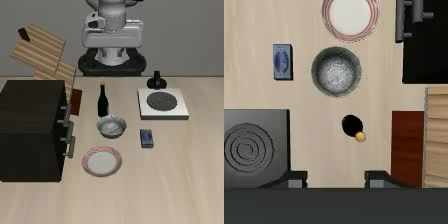
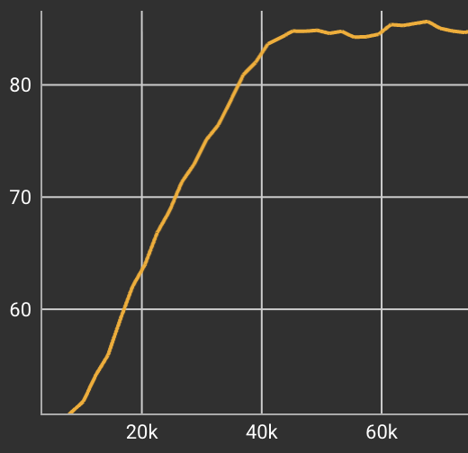
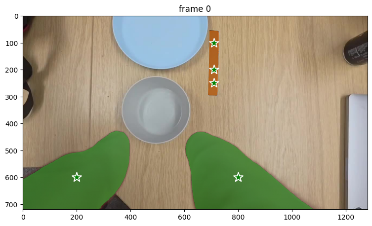
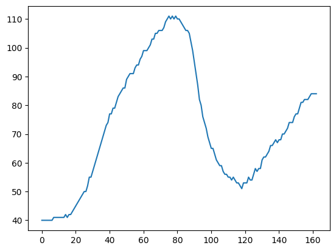
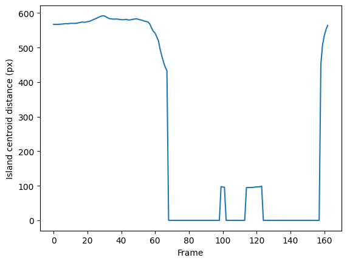
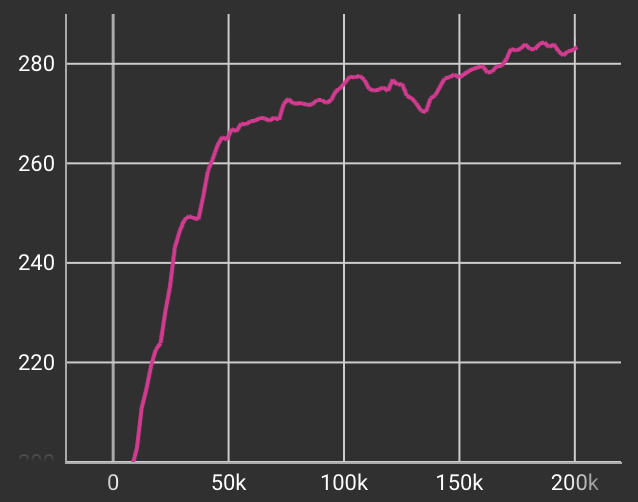
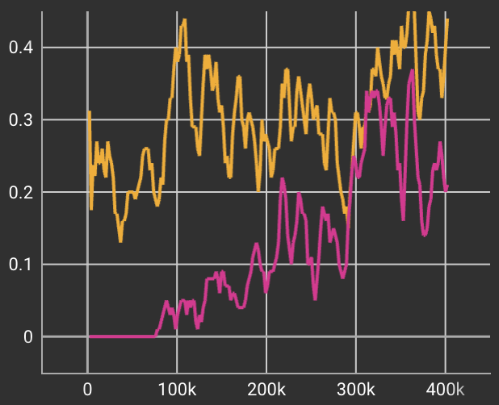

# Learning From Shoddy Human Demonstration

> It is often said: "Imitation is the sincerest form of flattery that mediocrity can pay to greatness." But in the field of robotics, imitation is the true greatness.

<table border="0">
	<tr><td align="center">
		 
		Fig. 1: LIBERO Goal task 8: move the bowl onto the plate.
	</td></tr>
</table>

This is an image of task 8 in the Libero goal benchmark suite. The robot is asked to pick up the bowl and place it on the plate.

By learning from 50 episodes of teleoperated demonstrations, numerous papers have reported close to 100\% success rate just from pure behaviour cloning. Teleoperated data have zero visual gap and morphology gap, hence establishing the translation from current camera image to next robot action is relatively easy to do.

https://alpha-nist.github.io/ also showed very recently that massively parallel simulation can brute force the emergence of very dexterous multistep skills. Hell, GPT-Astra could probably zero-shot this bad boy if I'm willing to pay the cloud thinking machine some of my hard-earned cash. Alas, I'm not.

Acknowledging that some of these much better approaches exist, I want to explore an alternative route. This is a video I took on my phone, as the repo title suggests, shoddily produced:

<table border="0">
	<tr><td align="center">
		 
		Fig. 2: Phone-recorded human demonstration.
	</td></tr>
</table>

Any human who looks at this video will immediately say, "Ah, I know what to do." even though the appearance of the props are completely different in the simulation. That means this short video contains the necessary information to tell someone how to complete the task. Now, the hard problem is: how do we extract this information and give it to the robot in a way that it understands?

## Pre-trained visual encoders

Foundational pre-trained visual encoders are trained on internet-scale images to embed semantic understanding into a latent space. DINOv3 show superior depth and segmentation capabilities. EUPE Distils that information into a more compact model. 

I wonder if it is possible to leverage this embedding space to transfer some of the knowledge from the human video to the robot. If I calculate the similarity of the robot's wrist camera with frames from the human video, I can use this as a reward to bootstrap the RL.

Embed both the robot wrist image $z_r(j)$ and the human video frame $z_h(t)$ into embeddings $E_r$ and $E_h$. Then the similarity is just the cosine of the embedded vectors

$$
\mathrm{sim}(\mathbf{E}_R,\mathbf{E}_H)=
\frac{\mathbf{E}_R \cdot \mathbf{E}_H}
{\|\mathbf{E}_R\|_2\,\|\mathbf{E}_H\|_2}
$$

The RL converged within 60k steps to this:

<table border="0">
	<tr><td align="center">
		 
		Fig. 3: Robot evaluation after visual-similarity training.
	</td>
    <td align="center">
		 
		Fig. 4: Training curve (average reward vs simulation steps) for the visual-similarity run.
	</td></tr>
</table>

I'm blown away by how structurally similar it is already to the original video. The robot, like the human video, goes down towards the ball and even approaches the ball on the right-hand side. This is from purely comparing the direction of the high-dimensional vectors in the embedding space.

## More Supervisions

But the visual similarity alone wasn't able to carry the whole task to completion. Because once the robot picks up the ball, almost the entirety of the camera view is filled up by the bowl itself. Then, from that point on, all the frames look similar.

I engineered two more rewards to try to guide the robots into completing the task. 

<table border="0">
	<tr><td align="center">
		 
		Fig. 5: Prompt points in frame zero of the video for SAM 2 tracking of the fingers and tabletop tape.
	</td></tr>
</table>

By using the Segment Anything Model 2 (SAM 2), I track the location of the fingers and the black tape on the table in the original human video. This is not as generalizable as pure vision embedding similarity. But all I had to manually provide was a few prompt points on the very first frame of the video.

The tracked fingers are used to calculate a gripper open/close state. And the width of the tape on the tabletop gives me an indication of how high the camera is. This is turned into two supervision signals. One guides the gripper to close. The other guides the robot to go down-up-down with its motion.

<table border="0">
	<tr></tr>
</table>

<table border="0">
	<tr><td align="bottom">
		 
		Fig.6: Object-height supervision from the tabletop tape.
	</td>
    <td align="bottom">
		 
		Fig.7: Gripper-state supervision from the human demonstration.
	</td>
    </tr>
</table>

Using these additional rewards, I get the following result:

The policy now successfully grabs the bowl and makes a vague attempt at trying to lift it.

<table border="0">
	<tr><td align="center">
		 
		Fig. 8: Robot evaluation with the combined reward signals.
	</td></tr>
</table>

<table border="0">
	<tr><td align="center">
		 
		Fig. 9: Training curve, reward vs steps, for the combined-reward run.
	</td></tr>
</table>

## The final hurdle

At this point, it seems that the engineered rewards no longer align with task success rate. More training or higher rewards does not improve success. Success rate sits still at zero.

This is the point where we should let go and let the robot explore the world and find its own success. In the final leg of training, the learning rate is turned down so that it does not deviate too much from the current policy. While the entropies increased to encourage exploration. Then, finally, once the policy is able to maintain a good level of success rate, all other rewards are turned off, so the policy can align itself to get the best success rate.

<table border="0">
	<tr><td align="center">
		 
		Fig. 10: Average success rate across 2 runs. First run in red with all reward signals, 2nd run in orange continuing from the first using only sparse success reward.
	</td></tr>
</table>

<table border="0">
	<tr><td align="center">
		 
		Fig. 11: Final robot policy. Success rate > 40%
	</td></tr>
</table>